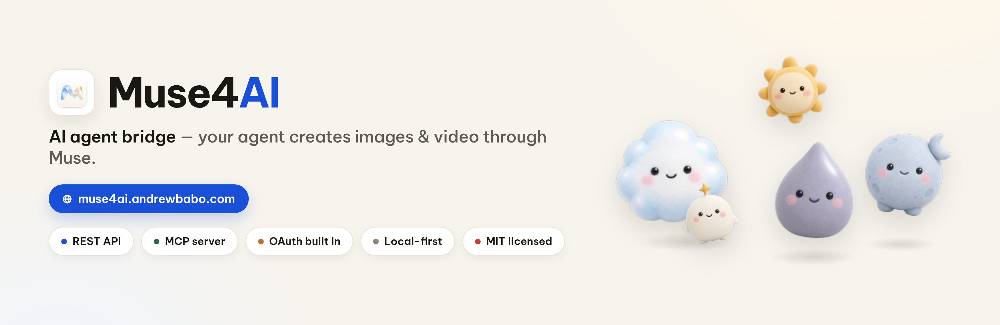
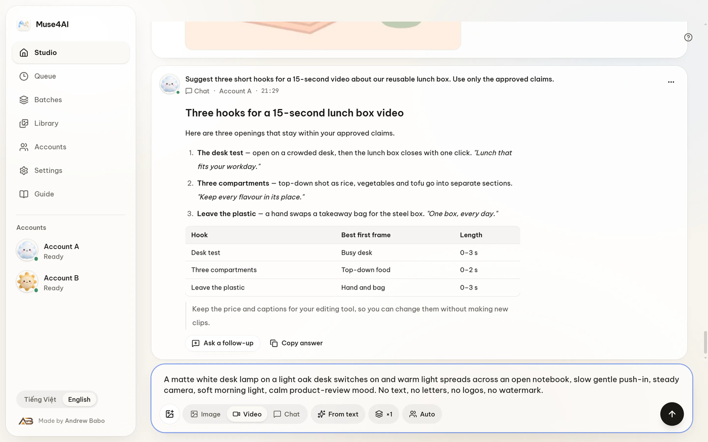
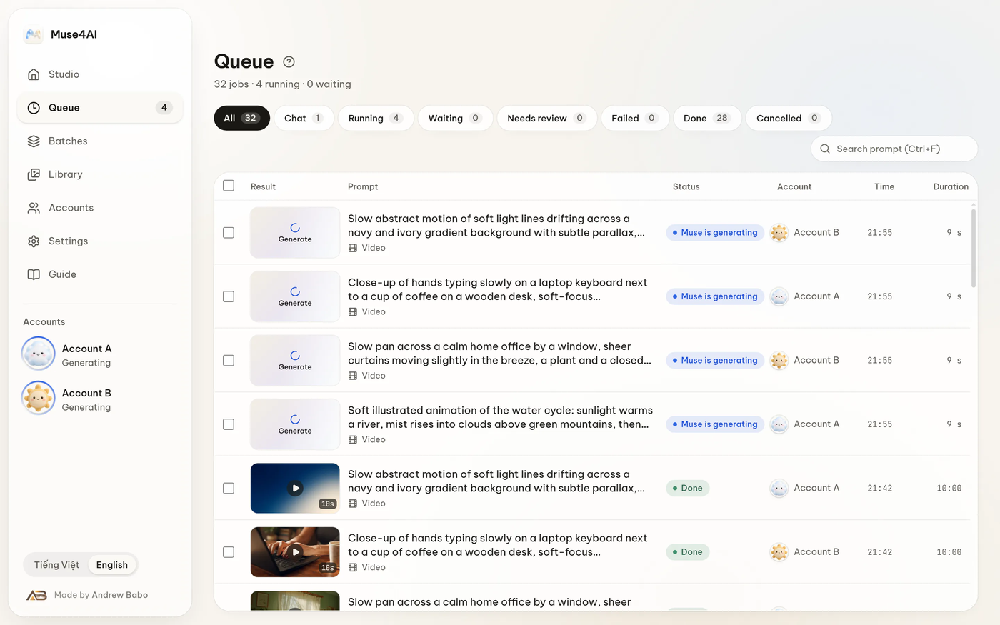
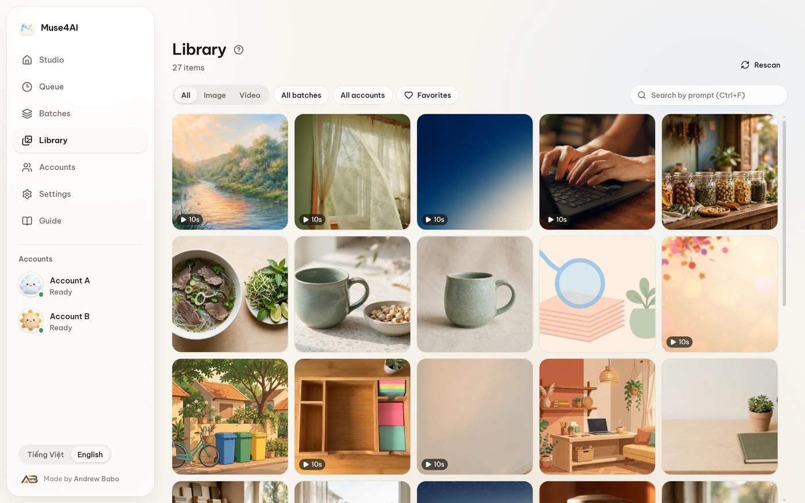
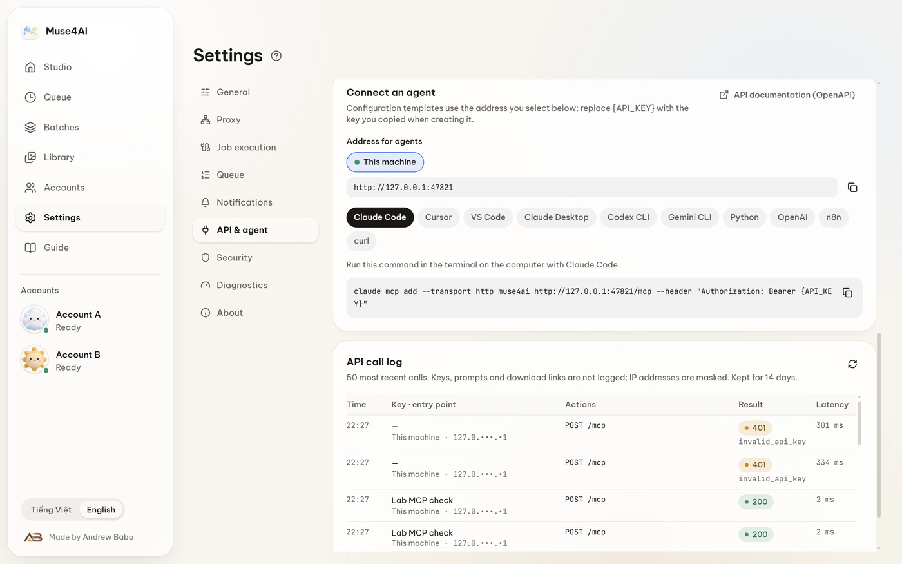

<div align="center">



# Muse4AI

**画像も動画も、AIエージェントに作らせましょう。**

Muse4AIはあなた自身のWindows PC上で動作し、あなたのMuseセッションをChatGPT、Claude、
Cursor、Codex、n8n、そのほか**REST**、**MCP**、**OAuth**を話せるあらゆるものに引き渡します。
クラウドの仲介者も、シート単位の料金もありません。

[**Webサイト**](https://muse4ai.andrewbabo.com) ·
[**ダウンロード**](https://muse4ai.andrewbabo.com/download) ·
[**ガイド**](https://muse4ai.andrewbabo.com/docs) ·
[**エージェント向け**](https://muse4ai.andrewbabo.com/agents) ·
[English](../README.md) ·
[Tiếng Việt](README-vi.md)


</div>

---

## 全体の仕組み

```text
   ChatGPT · Claude · Cursor · Codex · n8n · your own script
                       │
                       │  REST  ·  MCP  ·  OAuth
                       ▼
              ┌─────────────────────┐
              │   Muse4AI on your PC│   local library, queue,
              │   (Windows app)     │   keys, tokens, history
              └─────────────────────┘
                       │
                       │  your own signed-in Muse session
                       ▼
                     Muse
```

私たちが運営するサーバーを経由して中継されるものは何もありません。アプリはあなたのマシンから、
あなたのセッションでMuseと通信し、すべての結果、キー、トークンを同じマシン上の
`%APPDATA%\MuseStudio`に保存します。

## エージェントに頼めること

<table>
  <tr>
    <td width="50%">
      <h3>🎬 動画と画像の生成</h3>
      テキストのみでも、参考写真付きでも、1回の呼び出しで完了します。プロンプトを繰り返したり、アカウントを選んだりでき、
      アプリ内のキューに表示される様子を確認できます。
    </td>
    <td width="50%">
      <h3>💬 記憶するチャット</h3>
      質問したり、アイデアを練り直したりできます。会話IDが返されるため、
      エージェントはスレッドを続けたり、ファイルを添付したりできます。
    </td>
  </tr>
  <tr>
    <td>
      <h3>⏱ 完成した動画の延長</h3>
      生成されたのと同じ会話の中で、1つのチェーンにつき最大<b>6ステップ</b>、約<b>60秒</b>まで、
      クリップを続けて伸ばせます。
    </td>
    <td>
      <h3>🛠 説明するだけで動画を編集</h3>
      MP4を添付して、変えたいことを言葉で伝えるだけです。タイムラインもレンダリング設定も不要です。
    </td>
  </tr>
  <tr>
    <td>
      <h3>🔑 2つの接続方法</h3>
      一度貼り付けるだけの<b>APIキー</b>、または本物の<b>OAuth</b>です。エージェントが要求し、
      あなたはアプリの画面に表示される6桁のコードで承認します。
    </td>
    <td>
      <h3>📚 内蔵ガイド</h3>
      すべての画面に、実際のスクリーンショット付きのバイリンガルガイド(英語/ベトナム語)があり、
      さらにエージェントが読めるSkillも用意されています。
    </td>
  </tr>
</table>

## 実際の動作

<table>
  <tr>
    <td width="50%"></td>
    <td width="50%"></td>
  </tr>
  <tr>
    <td align="center"><b>Studio</b> — プロンプトを書き、参考資料を添付して、実行します。</td>
    <td align="center"><b>Queue</b> — ライブのステータス、サムネイル、クイックプレビュー。</td>
  </tr>
  <tr>
    <td></td>
    <td></td>
  </tr>
  <tr>
    <td align="center"><b>Library</b> — 作ったものすべてを検索できます。</td>
    <td align="center"><b>API &amp; agent</b> — 1回の貼り付けでエージェントを接続できます。</td>
  </tr>
</table>

## クイックスタート

### 1. インストール(最も簡単)

[ダウンロードページ](https://muse4ai.andrewbabo.com/download)からインストーラーを入手して実行し、
**Accounts**でMuseアカウントを追加してください。Windowsはファイルが署名されていないと警告するので、
**More info → Run anyway**を選んでください。その後は、アプリが自動で新しいバージョンを確認し、
**Settings › About**からインストールします。ここに戻ってくる必要はありません。

### 2. ソースから実行

**Node.js 22+**が必要です。

```bash
cd desktop
npm install
npm run build
npm start
```

アプリがデスクトップ上で開き、`http://127.0.0.1:47821`でAPIを提供します。

## エージェントを接続する

アプリで**Settings → API & agent**を開きます。キーがあらかじめ入力された、すぐに使えるスニペットが
表示されるので、エージェントの設定に貼り付けてください。

### OAuth(コピーするキーは不要)

このアプリは本物のOAuth認可サーバーです。`/.well-known/oauth-authorization-server`を公開し、
クライアントを動的に登録し、独自のトークンに署名します。エージェントをMCPエンドポイントに向けて、
リダイレクトさせてください:

```json
{
  "mcpServers": {
    "muse4ai": { "url": "http://127.0.0.1:47821/mcp" }
  }
}
```

するとアプリに**6桁のコード**が表示されます。それを同意ページに入力すると、トークンが
発行されます。リンクを知っているだけの人は、自分にアクセス権を与えることはできません。接続したアプリは、
後から**Settings → API & agent → Connected apps**でいつでも取り消せます。

### APIキー

同じ画面でキー(`msk_…`)を作成し、ベアラートークンとして送信します:

```bash
curl -X POST http://127.0.0.1:47821/v1/jobs \
  -H "Authorization: Bearer msk_YOUR_KEY" \
  -H "Content-Type: application/json" \
  -d '{"kind":"video","prompt":"a coffee cup on an oak desk, warm morning light"}'
```

キーはスコープが限定され、レート制限がかかり、個別に取り消せます。

### エージェントが使えるもの

| REST | MCPツール |
| --- | --- |
| `POST /v1/jobs` — 画像 / 動画 | `muse_generate` |
| `kind:"chat"`付きの`POST /v1/jobs` | `muse_chat` |
| `GET /v1/jobs` · `GET /v1/jobs/{id}` | `muse_list_jobs` · `muse_get_job` |
| `POST /v1/jobs/{id}/cancel` | `muse_cancel_job` |
| `POST /v1/assets/{id}/extend` · `POST /v1/conversations/{id}/extend` | `muse_extend_video` · `muse_get_extend` |
| `GET /v1/status` · `GET /v1/health` | `muse_status` |

機械可読な完全な仕様: `GET /v1/openapi.json`。
Markdownを好むエージェント向け: [llms.txt](https://muse4ai.andrewbabo.com/llms.txt)。

## プロジェクト構成

| パス | 置かれているもの |
| --- | --- |
| `desktop/` | アプリ本体 — メインプロセス、レンダラー、REST/MCP/OAuth API、テスト、インストーラー |
| `content/` | アプリとWebサイトで共有される、ガイド、エージェント、ユースケースのテキスト |
| `agent-kit/` | エージェントが自分でツールを学べるようにするMuse4AI Skill |

## 開発

```bash
cd desktop
npm test            # 848 tests
npm run typecheck   # strict TypeScript
npm run package:win # Windows ZIP + installer inputs
```

## 品質チェック

プッシュのたびに、そして毎週月曜日の02:00 UTCに、GitHub Actionsがスイート全体を再実行します:
**848件のテスト**、型チェック、依存関係の脆弱性スキャン、git履歴全体にわたるシークレットスキャン、
そして公開エンドポイントに対するライブチェックです。週次の実行が失敗すると、
自動的にissueが作成されます。

- 監査レポート: [docs/audit/2026-11-06.md](audit/2026-11-06.md)
- ビルド仕様、計画、ラボでの検証記録: [docs/build-3.3/](build-3.3/)(アップデート、ロールバック、アンインストール) ·
  [docs/build-3.2/](build-3.2/)
- 各バージョンの変更点: [CHANGELOG.md](../CHANGELOG.md)
- コントリビューション: [CONTRIBUTING.md](../CONTRIBUTING.md) · [行動規範](../CODE_OF_CONDUCT.md)
- 脆弱性の非公開での報告: [SECURITY.md](../SECURITY.md)

## 正直な注意事項

- **非公式。** Muse4AIは独立したプロジェクトです。**Meta Platforms, Inc.とは提携しておらず、
  承認やスポンサーも受けていません。**「Meta」と「Muse」はそれぞれの所有者の
  商標です。
- **リスクはあなたが負います。** このアプリは*あなたの*Museセッションを自動化します。Webアプリの自動化は
  サイトが変更されると動かなくなることがあり、Metaの利用規約に合わない可能性もあります。頼りにする前に
  利用規約を読んでください。
- **Windowsが先行。** macOSとLinuxのビルドはまだパッケージ化もテストもされていません。コアの
  コードはWindowsに依存していないため、移植はロードマップに入っています。
- **クラウドアカウントは不要。** サインアップも、テレメトリサーバーも、サブスクリプションもありません。

## ライセンス

[MIT](../LICENSE) © 2026 Andrew Babo. サードパーティの通知: `desktop/LICENSES/`。

質問やアイデアはこちら: [Webサイト](https://muse4ai.andrewbabo.com) ·
[ガイド](https://muse4ai.andrewbabo.com/docs) ·
[変更履歴](https://muse4ai.andrewbabo.com/changelog)。
