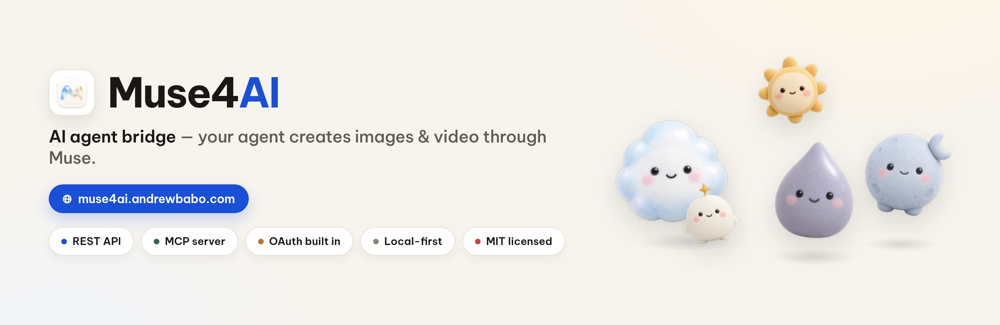
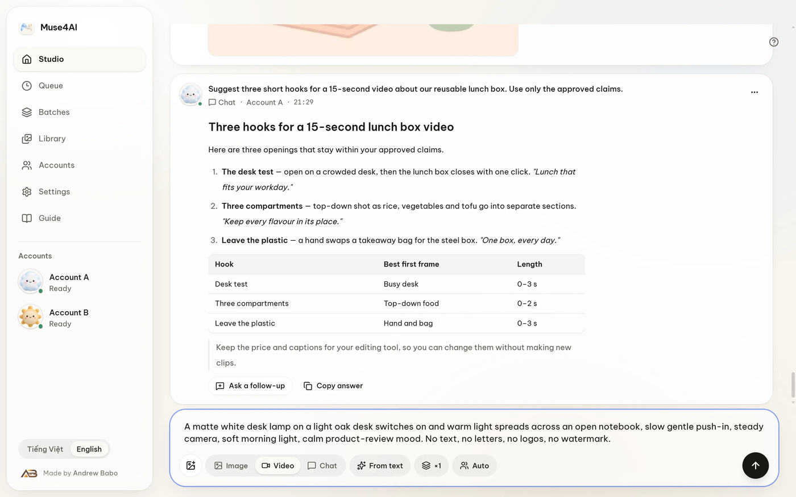
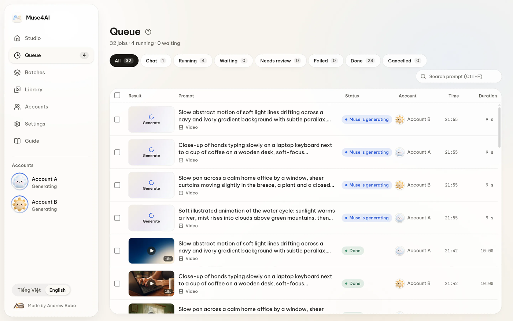
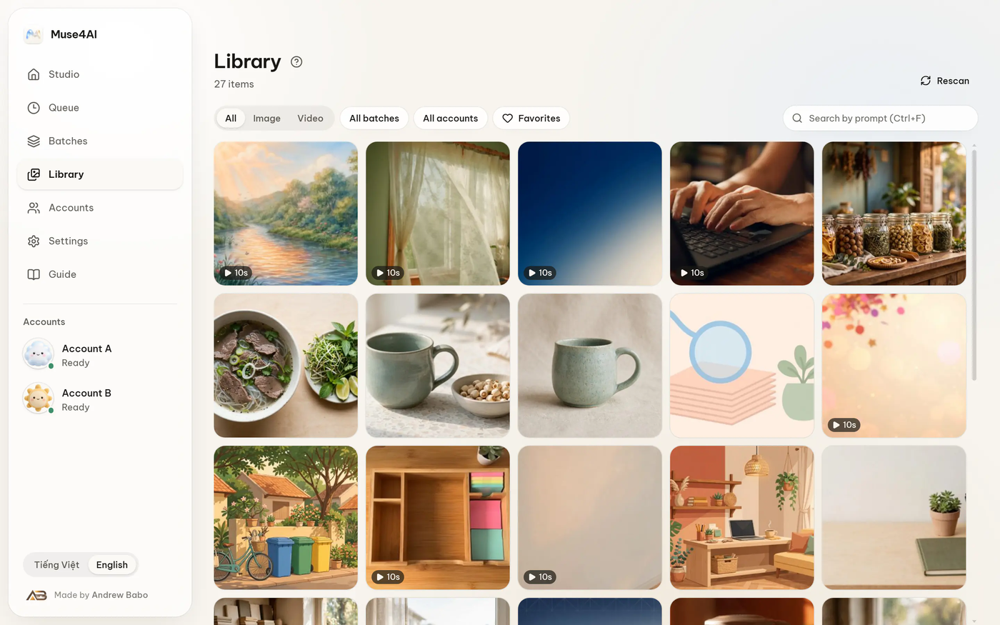
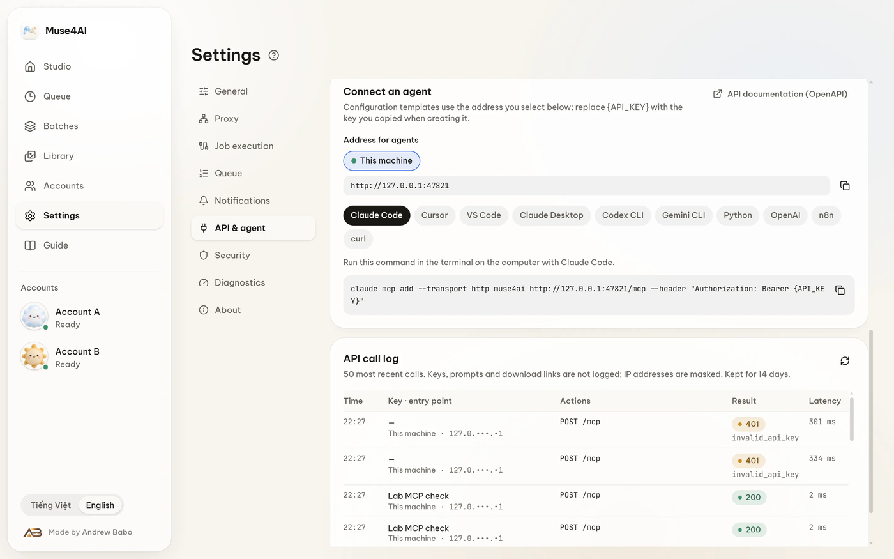

<div align="center">



# Muse4AI (bản tiếng Việt)

**Để AI agent tự tạo ảnh và video cho bạn.**

Muse4AI chạy ngay trên máy Windows của bạn và đưa phiên Muse của bạn cho ChatGPT,
Claude, Cursor, Codex, n8n hay bất cứ công cụ nào biết gọi **REST**, **MCP** hoặc
**OAuth** — không qua máy chủ trung gian, không phí theo lượt.

[**Website**](https://muse4ai.andrewbabo.com/vi) ·
[Tải về](https://muse4ai.andrewbabo.com/vi/download) ·
[Hướng dẫn](https://muse4ai.andrewbabo.com/vi/docs) ·
[Dành cho agent](https://muse4ai.andrewbabo.com/vi/agents) ·
[English](../README.md)


</div>

---

## Cách mọi thứ nối với nhau

```text
   ChatGPT · Claude · Cursor · Codex · n8n · script của bạn
                       │
                       │  REST  ·  MCP  ·  OAuth
                       ▼
              ┌─────────────────────┐
              │  Muse4AI trên máy bạn│   kho ảnh/video, hàng chờ,
              │   (app Windows)      │   khoá, token, lịch sử
              └─────────────────────┘
                       │
                       │  phiên Muse chính bạn đã đăng nhập
                       ▼
                     Muse
```

Không có dữ liệu nào đi qua máy chủ do chúng tôi vận hành. App gọi Muse từ máy bạn,
bằng phiên của bạn, và giữ toàn bộ kết quả, khoá, token trong
`%APPDATA%\MuseStudio` trên đúng máy đó.

## Bạn có thể nhờ agent làm gì

<table>
  <tr>
    <td width="50%">
      <h3>🎬 Tạo video &amp; ảnh</h3>
      Một lệnh duy nhất, chỉ cần chữ hoặc kèm ảnh tham chiếu. Lặp lại một prompt,
      chọn tài khoản, theo dõi ngay trong hàng chờ của app.
    </td>
    <td width="50%">
      <h3>💬 Hội thoại nhớ nhau</h3>
      Hỏi đáp hoặc chỉnh ý tưởng nhiều lần. App trả lại mã hội thoại để agent
      giữ mạch và đính kèm tệp khi cần.
    </td>
  </tr>
  <tr>
    <td>
      <h3>⏱ Kéo dài video đã có</h3>
      Cho đoạn phim chạy tiếp, tối đa <b>6 bước</b> và khoảng <b>60 giây</b> mỗi chuỗi,
      ngay trong hội thoại đã sinh ra nó.
    </td>
    <td>
      <h3>🛠 Sửa video bằng lời</h3>
      Đính một tệp MP4 rồi viết ra điều muốn sửa — không cần dòng thời gian,
      không cần chỉnh thông số dựng.
    </td>
  </tr>
  <tr>
    <td>
      <h3>🔑 Hai cách kết nối</h3>
      <b>Khoá API</b> dán một lần, hoặc <b>OAuth</b> thật: agent xin quyền và bạn
      duyệt bằng mã 6 số đang hiện trong app.
    </td>
    <td>
      <h3>📚 Hướng dẫn có sẵn</h3>
      Mọi màn hình đều có hướng dẫn tiếng Việt / tiếng Anh kèm ảnh thật,
      cùng một Skill để agent tự học cách dùng.
    </td>
  </tr>
</table>

## Xem nhanh

<table>
  <tr>
    <td width="50%"></td>
    <td width="50%"></td>
  </tr>
  <tr>
    <td align="center"><b>Studio</b> — viết prompt, kèm ảnh tham chiếu, chạy.</td>
    <td align="center"><b>Hàng chờ</b> — trạng thái thật, hình thu nhỏ, xem nhanh.</td>
  </tr>
  <tr>
    <td></td>
    <td></td>
  </tr>
  <tr>
    <td align="center"><b>Thư viện</b> — mọi thứ bạn đã tạo, tìm được.</td>
    <td align="center"><b>API &amp; agent</b> — nối agent bằng một lần dán.</td>
  </tr>
</table>

## Bắt đầu

### 1. Cài bản dựng sẵn (dễ nhất)

Tải bộ cài từ [trang Tải về](https://muse4ai.andrewbabo.com/vi/download), chạy nó,
rồi thêm tài khoản Muse trong mục **Tài khoản**. Windows sẽ báo file chưa ký số —
chọn **Thêm thông tin → Vẫn chạy**.

### 2. Chạy từ mã nguồn

Cần **Node.js 22+**.

```bash
cd desktop
npm install
npm run build
npm start
```

App mở ra trên màn hình và phục vụ API ở `http://127.0.0.1:47821`.

## Nối một agent vào

Mở **Cài đặt › API & agent** trong app. Màn hình này có sẵn đoạn cấu hình đã điền
khoá của bạn — chỉ việc dán vào agent.

### OAuth (không phải copy khoá)

App tự là một máy chủ OAuth thật: công bố `/.well-known/oauth-authorization-server`,
tự đăng ký client và tự ký token. Trỏ agent về MCP endpoint rồi để nó tự chuyển hướng:

```json
{
  "mcpServers": {
    "muse4ai": { "url": "http://127.0.0.1:47821/mcp" }
  }
}
```

Sau đó app hiện một **mã 6 số**. Bạn gõ mã đó vào trang xác nhận thì token mới được cấp.
Người chỉ biết đường link không tự mở quyền được. Muốn ngắt app nào, vào
**Cài đặt › API & agent › Ứng dụng đã kết nối**.

### Khoá API

Tạo khoá ngay trên màn hình đó (`msk_…`), rồi gửi kèm làm bearer token:

```bash
curl -X POST http://127.0.0.1:47821/v1/jobs \
  -H "Authorization: Bearer msk_KHOA_CUA_BAN" \
  -H "Content-Type: application/json" \
  -d '{"kind":"video","prompt":"tách cà phê trên bàn gỗ sồi, ánh sáng buổi sáng"}'
```

Khoá có phạm vi riêng, giới hạn tần suất và thu hồi được từng cái.

### Agent gọi được gì

| REST | Tool MCP |
| --- | --- |
| `POST /v1/jobs` — ảnh / video | `muse_generate` |
| `POST /v1/jobs` với `kind:"chat"` | `muse_chat` |
| `GET /v1/jobs` · `GET /v1/jobs/{id}` | `muse_list_jobs` · `muse_get_job` |
| `POST /v1/jobs/{id}/cancel` | `muse_cancel_job` |
| `POST /v1/assets/{id}/extend` · `POST /v1/conversations/{id}/extend` | `muse_extend_video` · `muse_get_extend` |
| `GET /v1/status` · `GET /v1/health` | `muse_status` |

Bản máy đọc được: `GET /v1/openapi.json`.
Bản cho agent đọc bằng Markdown: [llms.txt](https://muse4ai.andrewbabo.com/vi/llms.txt).

## Thư mục trong mã nguồn

| Đường dẫn | Bên trong có gì |
| --- | --- |
| `desktop/` | App — tiến trình chính, giao diện, API REST/MCP/OAuth, test, bộ cài |
| `content/` | Nội dung hướng dẫn, agent, tình huống dùng chung cho app và website |
| `agent-kit/` | Skill Muse4AI để agent tự học cách dùng tool |

## Phát triển

```bash
cd desktop
npm test            # 740 test
npm run typecheck   # TypeScript kiểm tra chặt
npm run package:win # đóng gói ZIP + bộ cài Windows
```

## Nói thẳng

- **Không chính thức.** Muse4AI là dự án độc lập, **không liên kết, không được Meta
  Platforms, Inc. bảo trợ hay giới thiệu**. "Meta" và "Muse" là nhãn hiệu của chủ sở hữu.
- **Bạn tự chịu trách nhiệm.** App tự động hoá phiên Muse *của bạn*. Trang web đổi thì
  app có thể hỏng, và việc tự động hoá có thể không phù hợp điều khoản của Meta —
  hãy đọc điều khoản trước khi phụ thuộc vào app.
- **Windows trước.** Bản macOS và Linux chưa được đóng gói hay chạy thử; phần lõi không
  phụ thuộc Windows nên việc chuyển hệ nằm trong kế hoạch.
- **Không có tài khoản cloud.** Không đăng ký, không gửi số liệu về máy chủ riêng,
  không thu phí định kỳ.

## Giấy phép

[MIT](../LICENSE) © 2026 Andrew Babo. Thông tin bên thứ ba: `desktop/LICENSES/`.

Câu hỏi hoặc góp ý: [website](https://muse4ai.andrewbabo.com/vi) ·
[hướng dẫn](https://muse4ai.andrewbabo.com/vi/docs) ·
[thay đổi](https://muse4ai.andrewbabo.com/vi/changelog).
